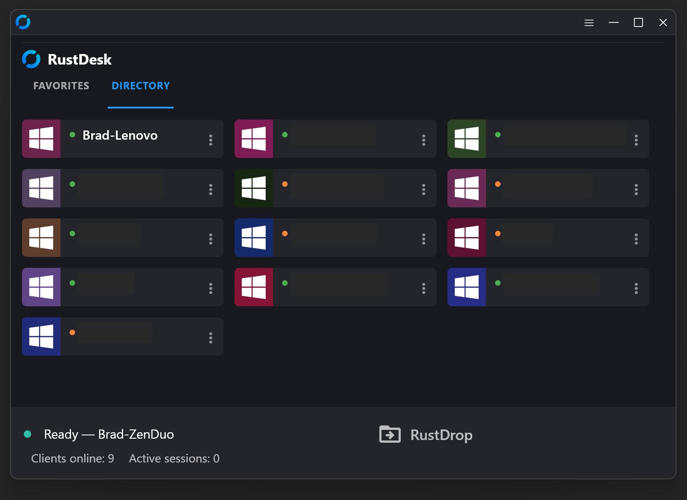
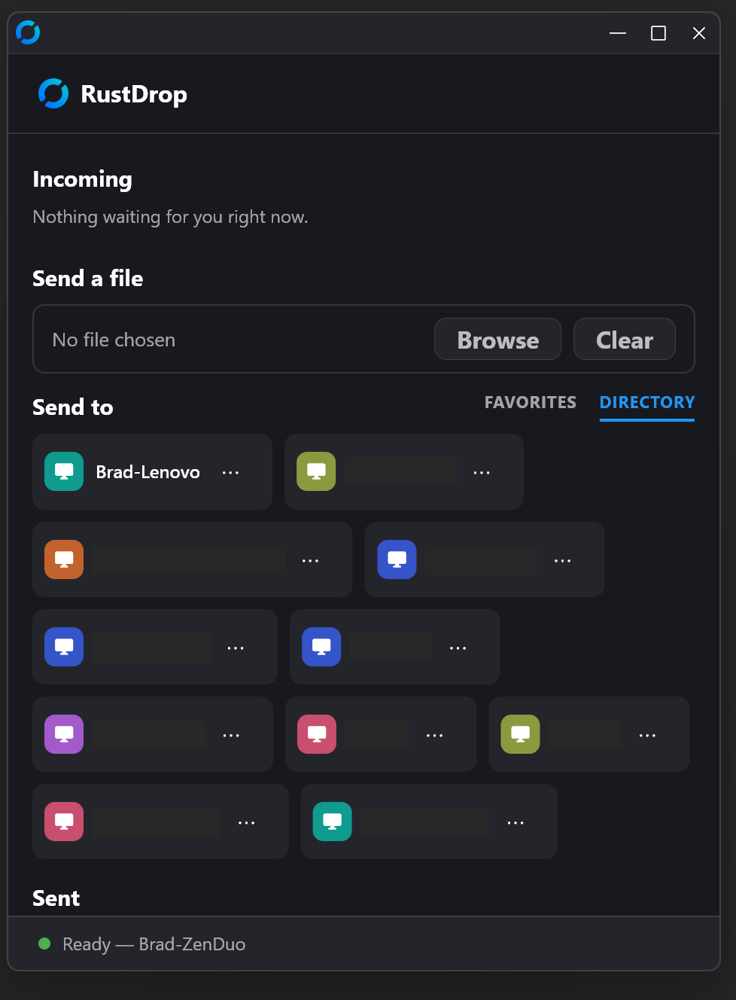
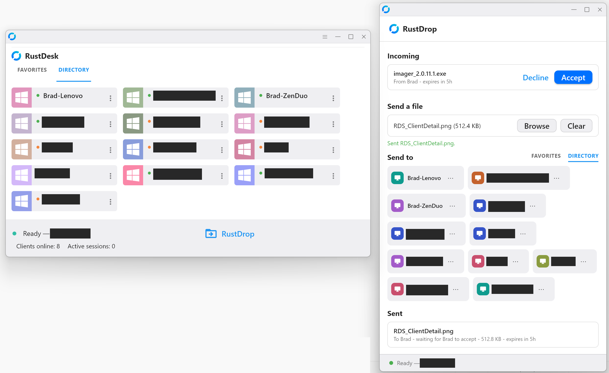
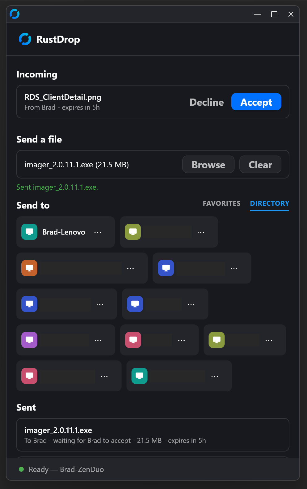
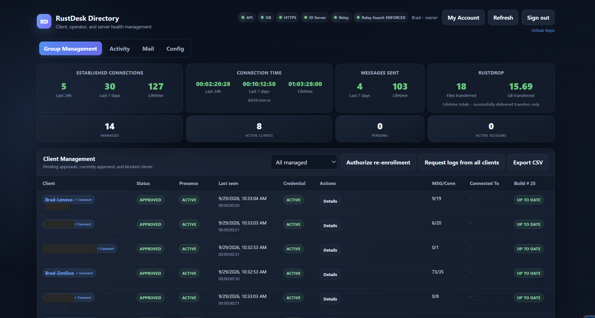
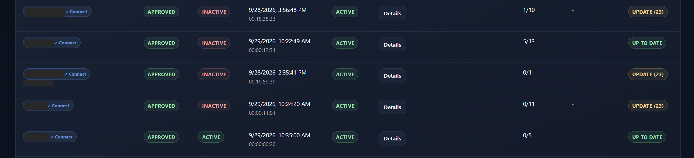
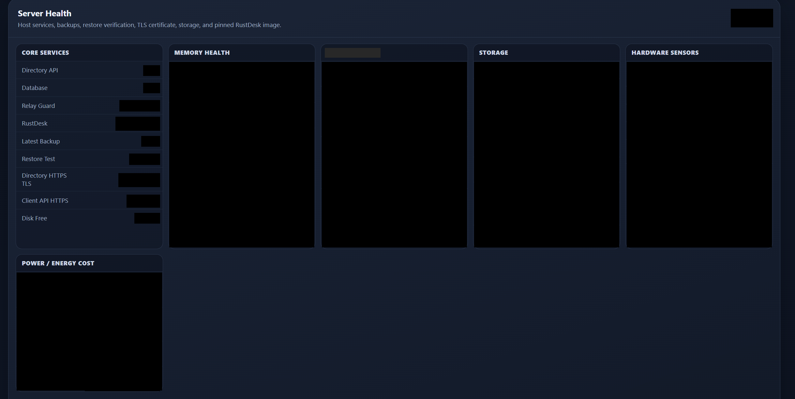

# RustDesk Directory API (RDS)

> Built to run alongside a self-hosted [RustDesk](https://github.com/rustdesk/rustdesk) deployment —
> not affiliated with or endorsed by RustDesk. None of this exists without the RustDesk project: the
> [client](https://github.com/rustdesk/rustdesk), the
> [server](https://github.com/rustdesk/rustdesk-server), and the wider self-host ecosystem
> (https://rustdesk.com/docs/en/self-host/). Full credit to the RustDesk team and contributors — this
> is original code written to add self-hosted Pro-tier-style management features (enrollment, 2FA,
> audit logging, relay-access leasing, device certificates and passports, admin UI) on top of the
> open-source server, not a modified copy of any RustDesk source.

A self-hosted management layer for a private RustDesk deployment: device enrollment, operator
accounts with 2FA, audit logging, relay-access leasing, accounts for RustDWeb browser access,
phone pairing for the RDC Mobile Manager app, and an admin web UI, sitting in front of your own
hbbs/hbbr (rendezvous/relay) server.

This directory does not build or run hbbs/hbbr itself — build the `rustdesk-server` source one level
up (or run a published RustDesk server image) separately. Nothing here is configured with the
hbbs/hbbr address: edit the `rustdesk_server` placeholder in `app/security_extension.py`. The health
collector expects containers named `rustdesk-hbbs`/`rustdesk-hbbr` on the same host, the
Caddyfile expects their WebSocket listeners on `127.0.0.1:21118`/`21119`, and the approved-ID sync
writes into the relay's data directory, `/opt/rustdesk-oss/data` (its staging directory,
`/opt/rustdesk-oss/sync-staging`, must be on the same mount).

## RustDrop

Resumable, end-to-end encrypted file drops between managed Clients (`app/rustdrop.py`). This
service authorizes and brokers each drop — does the sender own it, is the recipient the addressee —
but never sees plaintext file contents (file names and sizes are visible to it); it relays
ciphertext to a separate, single-purpose blob store (see the
[rustdrop-storage](https://github.com/MAGA-Brad/rustdrop-storage) repo) that knows nothing about
device identity at all. Configured via `RUSTDROP_STORAGE_BASE_URL` and `RUSTDROP_STORAGE_SECRET` in
`.env`; both are required, so the stack won't start without a RustDrop storage backend. Place that
backend's CA certificate at `config/rustdrop-storage-ca.pem`. A drop can name only its sender's
own registered key (the one the recipient decrypts with), a sender can cancel a drop until the
recipient starts receiving it, and deleting a Client deletes its drops and their stored files
(migration `052`). Still in active development.

## Screenshots

| | |
|---|---|
|  |  |
|  |  |
|  |  |
|  | |

## Layout

- `app/` — FastAPI application (`main.py` plus `admin_ui.py`, `security_extension.py`,
  `mobile_api.py`, `mobile_keys.py` for phones paired by a hardware key, `managed_chat.py`,
  `device_logs.py`, `rustdrop.py`, `rustdweb.py` for RustDWeb accounts and the gateway's routes,
  `sealed.py` for the sealed transport, `edge_certs.py` for edge client certificates,
  `device_sync.py` for change-driven sync, `server_vitals.py` and `sas_health.py` for the power
  history, the phone app's Server tab and the SAS tab, and `ca_link.py`, the job link the passport
  CA VM pulls from), built and run via `compose.yml`. The device-key proof and the sign-in rules
  live in `main.py`. `diag_jobs.py` (signed diagnostic scripts) and `nettest.py` (a network-test
  upload) are switched off and kept only as history: `main.py` doesn't register their routes. The
  `Dockerfile` installs the exact versions pinned in `requirements.txt` (resolved from
  `requirements.in`; change the pins on purpose, rebuild under a new `RDS_API_TAG` and smoke-test
  sign-in, sealed calls and device proofs before moving the tag) on a base image pinned by digest;
  `.dockerignore` keeps edit backups, caches and `.env` out of the image.
- `ca/` — the device-passport CA, which runs on its own VM, not in this stack: `ca/passport` is the
  passport format crate (shared with the relay's passport check) and `ca/signer` the signer
  (`ca-signer run|gen-root|root-pubkey|import <file>|verify-log|version [--config path]`, config
  in `/etc/ca-signer/config.json` by default). Build with `cargo build --release` in
  `ca/signer`; a static musl build runs on a minimal VM.
- `migrations/` — schema migrations, applied in file-name order (`017a_…` sits between 017 and
  018). There is no automated runner; apply each file with `psql` against the `database` container
  the first time you stand up the stack (see First-time setup). They apply cleanly to an empty
  database; no account has to exist first. When you update an existing stack, apply the new files
  before restarting the API on the new code (`053` adds a column every sign-in reads); the files
  say when they are safe to run twice. `047`–`050` add RustDWeb, the Linux gateway platform, the
  device-key proof and end-to-end chat switches, and paired phones; `051` is the diagnostic-job
  table kept as history; `052` and `053` carry fixes from a platform audit; `054` and `055` hold
  the power and SAS drive history.
- `compose.yml` / `compose.override.yml` — the `database` (Postgres), `api` and `ca-link`
  services. The API image is tagged `localhost/rds-api:${RDS_API_TAG}` (default `current`), and
  `ca-link` runs the same image without ever pulling it, so a rollback is setting the previous
  tag and `docker compose up -d api ca-link`. Both drop every Linux capability and run with
  `no-new-privileges`, a process limit and a memory limit. `ca-link` listens on port 9443 of
  `CA_LINK_BIND` (an internal interface only the CA VM can reach) and accepts only client
  certificates signed by the link CA in `config/ca-link/`.
- `.env.example` — copy to `.env` and fill in real secrets before starting the stack
  (`docker compose up -d`); `RDS_API_TAG`, the image tag (`current` when unset), goes there too.
  The ops scripts assume the stack lives in `/opt/rustdesk-directory`; the first-Owner bootstrap
  reads its secret from `config/secrets.env`.
- `deploy/caddy/Caddyfile` — example reverse-proxy config for five vhosts: a public rendezvous
  domain (also carrying the `/ws/id` and `/ws/relay` WebSocket routes), an ops/admin domain, a
  managed-client API domain, a separate RustDrop transfer domain, and a WebSocket fallback domain
  for clients built with `RUSTDESK_MANAGED_WS_FALLBACK_HOST`. Every vhost uses the same TLS line
  (`TLS_CERT`/`TLS_KEY` from Caddy's environment, or `tls` settings of your own) and the same
  client-address handling: if you run behind a CDN or proxy, set its address ranges and client-IP
  header in the commented `trusted_proxies` block. Adjust the domains for your own edge. The
  API upstream keeps idle connections for 3 s, shorter than uvicorn's 5 s, so a request never
  lands on a connection uvicorn is closing.
- `deploy/sbin/` — operational scripts (backups, backup verification, relay-guard mode CLI and
  firewall-sync daemon, health collector, signed update-bundle publisher, first-Owner bootstrap,
  owner emergency recovery, an SSH-only host firewall, a Caddy root-permission preflight, and a
  per-minute sync that gives relays built from rustdesk-managed-relay their approved IDs, the
  identity-key fingerprints for the passport check and the Remote Connections settings, and
  returns hbbs's encryption and passport counts).
  Intended to live at `/usr/local/sbin/` on the host. The daily backup archives the database plus
  `.env`, `config/`, the Caddyfile and its certificates, so every backup holds the stack's secrets
  (root-only, 14 days kept); the restore test allows small row-count drift in busy tables but
  none in the accounts. The health collector reports each check as its own alert condition
  (`server_health:<check>`, including the CA signer), over loopback first. The emergency recovery
  runs only when exactly one Owner exists and works inside the API container with the key the
  running stack uses; it revokes the Owner's sessions and, unless you keep them, its paired phones
  and push tokens, and voids unused pairing codes.
- `deploy/systemd/` — unit/timer files wiring the backup, restore-verify, relay-guard sync,
  approved-ID/settings sync, health-collector and host-firewall scripts into systemd; the rest are
  run by hand. Intended to live at `/etc/systemd/system/`.

## First-time setup (sketch)

1. `cp .env.example .env` and fill in strong random secrets. The first-Owner bootstrap reads its
   own copy from `config/secrets.env`; put the same `TOTP_ENCRYPTION_SECRET=` line there. (The
   emergency recovery script uses the running API's key instead.)
2. `docker compose up -d database`, then apply every migration in order, stopping at the first
   error:
   ```sh
   for f in $(LC_ALL=C ls migrations/*.sql); do
     echo "$f"
     docker exec -i rustdesk-directory-db psql -X -q -v ON_ERROR_STOP=1 \
       -U rustdesk_directory -d rustdesk_directory < "$f" || break
   done
   ```
3. Create the first (Creator-)Owner account, as root on the host:
   `bash deploy/sbin/rustdesk-owner-bootstrap`. It asks for a username, display name and password,
   enrolls an authenticator (TOTP) and inserts the one Owner the database allows to be created
   directly; it refuses to run once any Owner exists, and prints the new account's id. Invite
   everyone else from the dashboard afterwards.

   Then make that account the protected primary Owner. The code recognises it by two hard-coded
   values, and **both** must match it:
   - **Username** (placeholder `owner`). Only this value decides who gets the Mail and Config tabs
     (SMTP, security, power, RustDrop, RustDWeb, enrollment-password and Remote Connections
     settings) and device-log requests, both in the dashboard and in the API, and which account
     the dashboard shows as protected. Either name your first
     Owner `owner`, or change every copy: `PROTECTED_BRAD_USERNAME` in `app/main.py`, `isBrad()`
     and `isProtectedBradAccount()` in `app/admin_ui.py`, and the four `username = 'owner'`
     checks in migration 023.
   - **Account id** (`PROTECTED_BRAD_ACCOUNT_ID` in `app/main.py`, shipped as the all-zero
     placeholder). This is **required**: alert emails go only to the email address of the account
     with this id, so with the placeholder no alert mail is ever sent. (Lifecycle/role protection
     in the API and in 023's trigger matches either the username or the id.) Get the id from the
     bootstrap output or with
     `docker exec rustdesk-directory-db psql -U rustdesk_directory -d rustdesk_directory -Atc "SELECT creator_owner_id FROM directory_instance"`.
     Set it in `app/main.py`, replace the four all-zero UUIDs in migration 023 with it, and
     re-apply 023, which is safe to re-run:
     `docker exec -i rustdesk-directory-db psql -X -q -v ON_ERROR_STOP=1 -U rustdesk_directory -d rustdesk_directory < migrations/023_operator_account_lifecycle_delete.sql`
   - Optionally, a second protected Owner account used by the phone app
     (`PROTECTED_OWNER_PHONE_ACCOUNT_ID` and `PROTECTED_OWNER_PHONE_USERNAME` in `app/main.py`,
     shipped as placeholders): only the primary Owner, or that account itself, can change it.

   The protected accounts have no web access reset: if their password or authenticator is lost,
   `deploy/sbin/rustdesk-owner-emergency-recovery` (root, on the host) resets the Owner, and it
   runs only while that Owner is the only one.

   `app/` is built into the api image, so make these edits before step 4, or rebuild afterwards
   with `docker compose up -d --build api`. Once you are signed in, open **My Account** and set
   that account's email address so alert mail has a recipient. Alert mail also needs
   `SMTP_ENCRYPTION_SECRET` in `.env` and an enabled SMTP server on the Mail tab.
4. Set `FORWARDED_ALLOW_IPS` in `.env` (`compose.yml` passes it to the API) to your Docker
   network's gateway address (otherwise every client appears to come from the gateway), then
   `docker compose up -d api`. This builds the image as `localhost/rds-api:${RDS_API_TAG}`; give
   each later build a new `RDS_API_TAG` in `.env` and rebuild with
   `docker compose up -d --build api`, so rolling back is setting the previous tag and
   `docker compose up -d api ca-link`.
5. Put `deploy/caddy/Caddyfile` in place, reverse-proxying to `127.0.0.1:21120`. Edit the domains
   first, set `TLS_CERT`/`TLS_KEY` in Caddy's environment (or change the `tls` line to suit your
   edge) and, if you run behind a CDN or proxy, fill in its commented `trusted_proxies` block.
6. Sign in to the dashboard as the primary Owner and set the **Server Enrollment Password** on the
   Config page. It's the one shared secret Clients enroll with (a new one revokes every other);
   installers from build 45 check it with RDS before they change anything.
7. Install the scripts in `deploy/sbin/` and units in `deploy/systemd/` if you want the backup,
   relay-guard, and health-collector automation. Edit the SSH source range in
   `rustdesk-host-firewall` before enabling it, or you will lock yourself out.
8. Generate your own hbbs/hbbr keypair and TLS certificates — none are included here.
9. Peer authentication (device certificates), optional but recommended:
   - **Create the CA key.** Generate one as described in `.env.example` and set
     `PEER_CA_PRIVATE_KEY`. Apply it with `docker compose up -d api` (a plain restart doesn't
     re-read `.env`), then read the CA public key from `GET /v1/peer-auth/ca`.
   - **Build the client against it.** Set `RUSTDESK_MANAGED_PEER_CA_PUBKEY` to that public key in
     the build environment. Approved Clients then fetch and renew their own certificates.
   - **Roll out in log mode.** Leave the mode at **log** (the default) on the Config page →
     Remote Connections. Watch the readiness count there, and switch to **enforce** once every
     active Client runs a build that presents certificates.
   - **Guard the key.** It lives only in `.env`. The bundled backup script archives `.env` with
     the database, but on the same host, so keep a copy of the key somewhere else too. Rotating it
     means rebuilding the client with the new public key, and in enforce mode logins fail until
     every Client runs the rebuilt client.
10. Sealed transport, optional but recommended: generate an X25519 key pair, set the private half as
    `SEALED_X25519_PRIVATE_KEY` in `.env`, and build the client with `RUSTDESK_MANAGED_SEAL_PUBKEY`
    set to the public half. When rotating, move the old private key to
    `SEALED_X25519_PREVIOUS_PRIVATE_KEY` so Clients built before the rotation keep working. Like the
    CA key, keep a copy off the host. Clients from build 31 never fall back to unsealed calls, so a
    broken sealing setup cuts them off from RDS (update checks included) until the key they were
    built with is configured again.
11. Edge client certificates, optional: set `CF_EDGE_CERT_TOKEN` (a Cloudflare API token that can
    manage client certificates) and `CF_ZONE_ID`. Enforce the certificate at the edge only once
    every Client has one.
12. Rendezvous encryption and WebRTC need the relay build from
    [rustdesk-managed-relay](https://github.com/MAGA-Brad/rustdesk-managed-relay). Install the
    approved-ID/settings sync units, then choose the modes on the Config page → Remote
    Connections. Set encryption to **optional** before rolling out managed clients built from this
    tree (they can't connect while it's off; RDS won't let you switch it off while any approved
    Client reports build 30 or newer), and switch to **required** only once the counts there show
    no unencrypted connections. Leave WebRTC at **test devices only** until every Client is built
    with your own STUN server (`RUSTDESK_MANAGED_ICE_SERVERS`).
13. Device passports, optional:
    - **Stand up the CA VM.** Build `ca/signer`, create its root key with `ca-signer gen-root` and
      keep it as an encrypted systemd credential, issue the signer a client certificate from your
      link CA, and point its config at `https://<CA_LINK_BIND>:9443`. Start the `ca-link`
      service here with the link CA and server certificate in `config/ca-link/`.
    - **Build against it.** `ca-signer root-pubkey` reads the root seed on stdin and prints the
      root public key: build clients with `RUSTDESK_MANAGED_PASSPORT_ROOTS` set to it and start
      hbbs with `PASSPORT_ROOTS` set to it (in hbbs's own environment, not from RDS).
    - **Roll out.** Set issuing to **log** on the Config page, then press **Queue passports for
      approved devices without one** in the CA panel (Clients approved earlier aren't on the CA's
      file until then). Windows Clients from build 34 and RDC for Android move to their own identity
      key and fetch passports. Then set hbbs's passport check to **log**, watch its counts, try
      **test** with a few test devices, and switch to **enforce** once every active Client runs
      build 34 or newer. The Config page counts the older ones for you, but doesn't stop you:
      Enforce applies as soon as it's saved, and older Clients can't connect under it.
14. Device-key proof and end-to-end chat (Config page → Remote Connections): Clients from build 35
    sign every call with their identity key and seal chat to other build 35+ Windows Clients. The
    proof needs each Client's identity key on file, which arrives through the passport CA (step
    13). Both switches start in **log**. Watch the counts
    there (Clients that proved their key, sent no proof, have no key on file or sent an invalid
    proof; end-to-end versus plain chat sends), try **test** with the test-device list, then
    switch to **enforce**. Enrollment, updates and the identity-key calls are never refused.
15. RustDWeb, optional: build the gateway from rustdesk-managed-client (Linux,
    `--features rdc_gateway`; its own machine and TLS proxy), enroll and approve it like any Client,
    and put its **Device ID** (a UUID, shown in its details in Client Management) in **Gateway
    device id** on the Config page → RustDWeb, along with the session and lockout limits. Then
    Owners or Managers invite RustDWeb users (Viewer accounts) from the **RustDWeb Users** tab.
16. RDC Mobile Manager phone pairing, optional: on the host, run `create_pairing_code()` from
    `app/mobile_keys.py` inside the API container (`PYTHONPATH=/app`) for an active Owner or
    Manager account. The single-use code is valid for 7 days by default and goes into that phone's
    app build; the app pairs on first launch, the owner is mailed, and the phone shows up under
    **Paired phones** on the Config page, where it can be revoked.
17. Host watchers, optional: the Server Health host health and power readings (and UPS battery
    status, when a battery monitor reports it) come from watcher scripts on the host that aren't
    included here. They post JSON
    (`{"hostname": …, "metrics": {…}}`) to `POST /ops/api/internal/host-metrics` with the
    `X-Health-Watcher-Secret` header set to `HEALTH_WATCHER_SHARED_SECRET`, under the
    host-metrics keys in `app/server_vitals.py` (`hypervisor`, `hypervisor-power`,
    `hypervisor-infra`, `hypervisor-batteries`), and send alerts to
    `POST /ops/api/mobile/internal/health-event`. Set `LOCAL_TIMEZONE` in `app/sas_health.py` to
    your IANA time zone so the SAS tab's days start at your midnight.
